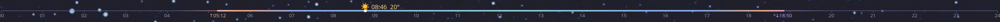

# Sky Line

Today's 24 hours spread across the panel, with the weather sitting at the current time.



- A line runs from 00 to 24, coloured like the sky (night, dawn pink, day blue, dusk lilac);
  daylight hours are thicker. A label for every hour.
- Sunrise (↑) and sunset (↓) times sit on the scale.
- A dot marks the current time, and above it an emoji shows the weather right now: sun, clouds,
  fog, drizzle, rain, snow or thunderstorm. On clear nights it shows the moon in tonight's phase.
  The time and temperature sit beside it.
- Tooltip: conditions, temperature, sunrise, sunset, daylight length and the moon phase.

It fills the space it's given, so it suits an empty stretch of a panel.

## Location

Right-click → **Configure Sky Line…** and enter your latitude and longitude (decimal degrees, north
and east positive). Or give a command that prints `lat,lon` (for example from a geolocation script);
it runs once an hour and wins over the fixed location.

Weather comes from [Open-Meteo](https://open-meteo.com/) (free, no key), every 15 minutes. Sunrise and
sunset use the SunCalc formulas (Vladimir Agafonkin, BSD-2-Clause); the moon phase uses the mean
synodic month, so it can be a few hours off the exact phase change.

## Settings

Right-click → **Configure Sky Line…** → **Appearance**:

- **Beside the weather icon:** current time and/or temperature; turn both off for just the icon.
- **Clock:** 24-hour (08:45) or 12-hour (8:45 AM; hour labels like 8a, 12p).
- **Temperature:** °C or °F.
- **Scale:** sunrise/sunset times on or off; hour labels every 1, 2, 3 or 6 hours; fade the hours already past.
- **Sizes:** weather icon (or *Fit*), hour labels, time/temperature, line thickness.

## Install

```bash
kpackagetool6 -t Plasma/Applet -i sky-line/package
```
