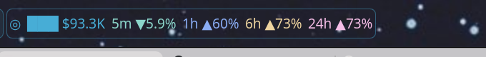

# Solana Watchlist

A KDE Plasma 6 panel widget that tracks the market cap of Solana tokens you choose, with
price change over 5 minutes, 1 hour, 6 hours and 24 hours in green (up) or red (down).



- **On the panel:** symbol, market cap and the price change for each time frame, green when
  up and red when down. Up to 3 tokens are shown, then `+N`.
- **Click it** for the full list. Each token shows its name, market cap, price, all four
  changes and its address, with buttons to set alerts, hide it from the panel, open it on
  DexScreener, copy the address, or remove it.
- **Market cap alerts:** the 🔔 button sets an "above" and/or "below" level per token
  (`50M`, `1.2B`, `300K`…). When the market cap reaches or crosses it you get a desktop
  notification with a sound, and that alert is cleared. A level the market cap is already
  past isn't saved.
- **Add a token** by pasting its address into the popup. It is checked against DexScreener
  before it's added.
- **Choose the time frames** shown on the panel with the checkboxes at the top of the popup,
  and whether the panel text sits on a **solid background** or a transparent one.
- **Live market cap, updated every ~5 seconds.**
- **Open in a window** with the button at the top of the popup: the same view as a normal
  window you can move, resize and keep open.

Market data comes from two public APIs, no key or account needed:

- [DexScreener](https://docs.dexscreener.com/) (for each token, the trading pair with the
  most liquidity) for supply, market cap and the 5m/1h/6h/24h changes. Its responses are
  cached at the CDN for 30 seconds, so it's fetched every 30 seconds.
- [Jupiter's price API](https://dev.jup.ag/docs/price-api) for the current price, fresh to
  about 5 seconds; the market cap is scaled to it between DexScreener updates.

All tokens go in one request per source, well inside both rate limits (Jupiter's free
tier allows about 5 requests per 10 seconds). If Jupiter is unreachable or rate-limited,
the widget falls back to DexScreener's price.

## Requirements

- KDE Plasma 6
- Python 3 (standard library only)
- `notify-send` (libnotify) for alerts

## Install

```bash
git clone https://github.com/jesperdote/plasma-widgets.git
kpackagetool6 -t Plasma/Applet -i plasma-widgets/solana-watchlist/package
```

Then right-click the panel → **Add Widgets…** → search for **Solana Watchlist**.

To update after a `git pull`:

```bash
kpackagetool6 -t Plasma/Applet -u plasma-widgets/solana-watchlist/package
```

For development, symlink the package instead, then restart Plasma to pick up changes
(`systemctl --user restart plasma-plasmashell.service`):

```bash
ln -s "$PWD/plasma-widgets/solana-watchlist/package" \
  ~/.local/share/plasma/plasmoids/com.github.jesperdote.solanawatchlist
```

## Watchlist file

Tokens are kept in `~/.config/sol-mc/watchlist`, which you can also edit by hand:

```
# One Solana token address per line, optional label after it.
DezXAZ8z7PnrnRJjz3wXBoRgixCa6xjnB7YaB1pPB263 BONK
-EKpQGSJtjMFqKZ9KQanSqYXRcF8fBopzLHYxdM65zcjm WIF
```

A leading `-` hides that token from the panel; it stays in the popup.

Alerts are kept separately in `~/.config/sol-mc/alerts.json`.

## Command line

The widget's backend also works on its own:

```bash
python3 package/contents/code/sol-mc             # one-line summary
python3 package/contents/code/sol-mc --tooltip   # one line per token
python3 package/contents/code/sol-mc --json      # what the widget reads
python3 package/contents/code/sol-mc --add ADDRESS   # also --remove, --hide, --show
python3 package/contents/code/sol-mc --alert ADDRESS above 50M below 30M   # "off" clears one
```

## Notes

- If you use [Panel Colorizer](https://github.com/luisbocanegra/plasma-panel-colorizer), its
  foreground colour would normally override the red/green; the widget puts it back.
- Token names come straight from DexScreener, so some meme tokens show odd symbols.
- Not financial advice; prices can lag or be missing for tokens with little trading.

## License

MIT
